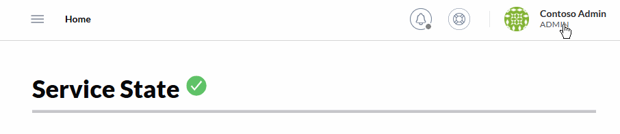
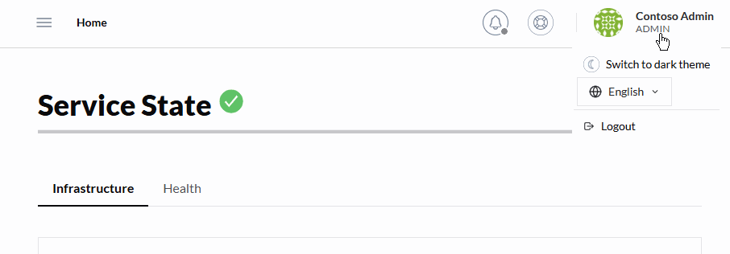

# Home

## Login Screen

You are presented with the login screen when you open your RADIUSaaS Admin Portal for the first time or when your access token has expired. The login screen provides an easily accessible option to download the CA certificate that has signed your [RADIUS Server Certificate](settings/settings-server.md#server-certificates). This feature is particularly useful for bring-your-own-device (BYOD) setups and administrators who need to create network profiles on their devices.

<figure><figcaption></figcaption></figure>

## Service State

The RADIUSaaS homepage presents you with an interactive service state that is **updated in** **real-time**.

### Infrastructure

When you access the homepage of your RADIUSaaS instance, the Infrastructure tab shows how authentications reach the RadSec servers of your RADIUSaaS instance. The availability of the individual components is monitored in **real-time** and realized through **actual authentications** (PAP-based) that are periodically performed.

<!-- TODO reviewer: confirm that the PAP-based availability check also applies to tunnels (Local Network Connections). -->

<figure><figcaption></figcaption></figure>

On the left, the authentication paths are grouped by how they reach RADIUSaaS:

| Group        | Protocol | Description                                                                                      |
| ------------ | -------- | ------------------------------------------------------------------------------------------------ |
| **Direct**   | TCP      | RadSec authentications sent directly by your authenticators.                                     |
| **Proxied**  | UDP      | RADIUS authentications relayed by your [RADIUS proxies](settings/settings-proxy.md), per region. |
| **Tunneled** | TCP, UDP | Authentications that arrive through a WireGuard or IPsec tunnel (Local Network Connections).     |

On the right, each RadSec server is shown in a box for its instance, for example **Main Instance**, together with its cluster and its public IP address.

The legend shows the state of each node: **Reachable** (green), **Unreachable** (red) and **No data** (grey). Tunnels are drawn as dashed lines (**VPN tunnel**).

By hovering over individual nodes, additional information is shown:

* **Proxy**: IP address, location and status
* **RadSec server**: location and status
* **Tunnel**: tunnel type (WireGuard or IPsec) and status

In case a node is detected to be malfunctioning, the node along with its path to the RadSec servers is highlighted in red, and a badge above the tabs shows how many issues need attention:

<figure><figcaption></figcaption></figure>

**Important:** As long as there is at least one green path leading to a **RadSec server**, the service is generally available. In case you are using RADIUS proxies, ensure that you have followed our architectural [recommendations](settings/settings-proxy.md) to decrease the likelihood that a proxy failure leads to an overall outage of the service.&#x20;

The **Service State** icon in addition to a healthy (green) state can indicate one of three error conditions.&#x20;

| Disabled                                                                   | Removed                                                                    | Expired / Not Yet Valid                                                    |
| -------------------------------------------------------------------------- | -------------------------------------------------------------------------- | -------------------------------------------------------------------------- |
|  |  |  |

### Health

The Health tab displays the health status of all components relevant to your RADIUSaaS instance:

* **Certificates**: your proxy and server certificates and the number of days until they expire
* **Revocation Lists (CRL)**: each revocation list, whether it is valid, and the cluster it is loaded on
* **SCEPman**: the optional SCEPman SaaS module
* **RadSec Servers**: status, IP address and cluster of each RadSec server
* **Proxies**: status, IP address and location of each RADIUS proxy
* **Local Network Connections**: status, cluster and tunnel type of each tunnel

If a component is down, a red box at the top of the tab lists it, followed by the number of errors, warnings and components that are ok.

<figure><figcaption></figcaption></figure>

## Other controls

The RADIUSaaS homepage gives you easy access to frequently used controls and information.

<figure><figcaption></figcaption></figure>

### Ask AI

Click **Ask AI** (or press **Ctrl+K**) to open the RADIUSaaS assistant. Ask in plain words about authentications, rules, certificates, groups or a setting. The assistant reads the live configuration and logs of your tenant, and shows you which settings an answer came from.


The assistant is read-only. It can explain and locate configuration, but it cannot change rules, users or certificates. Private keys, shared secrets and key-vault credentials are never included in a prompt.


Answers can be wrong, so verify them before you change any settings. A question can be up to 256 words long.

<!-- TODO reviewer: confirm whether Ask AI is available on all plans and tenants, and whether there are usage limits beyond the 256-word question length. -->

<figure><figcaption></figcaption></figure>

### Notifications

You can find notifications (alerts, configuration improvement notifications, important announcements) regarding your service in here.

<figure><figcaption></figcaption></figure>

### Help

Click on the life saver button to lodge a support request.

<figure><figcaption></figcaption></figure>

<figure><figcaption></figcaption></figure>

### Dark Mode

Click on the User Account button, followed by "Switch to dark/light theme" to toggle between dark and light mode.

<figure><figcaption></figcaption></figure>

### Language

The RADIUSaaS Portal is available in German, English, Spanish, French, Japanese and Portuguese.

<figure><figcaption></figcaption></figure>

### Service Documentation

A direct link to the RADIUSaaS documentation.

<figure><figcaption></figcaption></figure>

### API Documentation

A direct link the RADIUSaaS REST API Swagger documentation.

<figure><figcaption></figcaption></figure>


[rest-api](../other/rest-api/)

